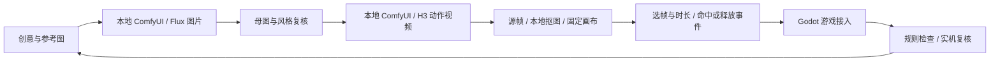

# RPGMakerLuna · 把一句创意，做成一个能玩的世界

**本地 AI 游戏创作平台｜6 款可进入的游戏｜2D / 2.5D / 3D｜图片 + 视频 + 动作资产生产｜游戏内自然语言迭代**

> **让想象力决定迭代次数，而不是每张图、每秒视频的账单。**
>
> 本地 ComfyUI 生图、生视频：已有硬件、模型与运行环境就位后，**除了电费，零额外生成费用**。不按张计费，不按视频秒数计费，不必为每次美术试错购买云端生成额度。

RPGMakerLuna 把自然语言创作、Godot 工程、AI 美术、视频动作、游戏规则和验证流程连成了一条生产线。玩家可以在大厅提出构想，进入独立游戏工程试玩，再打开游戏内助手继续修改。作品、素材和代码沉淀在本地，下一轮创作可以直接沿用。

**我们的野心：对标腾讯游点灵与 bilibili Toy，向更高的 AI 游戏质量与精细度发起挑战。** 质量要经得起逐项试玩：人物怎么动、攻击何时命中、牌局怎样结算、客人如何被服务、存档能否恢复，都有实际实现。这里的对标是产品目标；本仓库未提供同条件竞品基准测试，不将目标冒充已测排名。

## 先看全部作品：六款游戏，六种能力证明

游戏列表以 [`created-games/catalog.json`](created-games/catalog.json) 为准。它们共享创作入口，各自拥有独立工程与玩法。

| 游戏 | 已实现的高光 | 展示的技术能力 |
| --- | --- | --- |
| **晨钟城 · 姬骑士** | 城镇与古塔、三段攻击、施法、受击、队友战斗、任务分支、装备与掉落 | AI 全身动作与可交互动作 RPG 的结合 |
| **热血江湖** | 三职业武侠、可旋转三维视角、点击寻路、轻功、城镇交易、个人与共享仓库 | 3D 场景、角色系统、交互与持久化的系统集成 |
| **月汐食堂** | 手绘等距餐厅、双人餐桌、8 个顾客席位、自动备餐、双格托盘、倒水安抚、清桌与经营升级 | 本地 AI 美术支撑有节奏、有反馈的经营循环 |
| **绯夜 · 红木会所** | 六人德扑、五名不同风格 NPC、斗地主、动态荷官，以及二十一点、百家乐、五张换牌扑克 | 复杂规则、多人回合模拟与视频事件同步 |
| **地心探险** | 分层挖掘、同色连锁、预警落石、水晶与疲劳、每层 100 米探索、六个本地存档 | 环境交互、连锁反馈和持续探索 |
| **星光采集** | 方向键移动、10 星收集目标、计时、完成反馈、R 键重来 | 从自然语言到完整小型游戏循环的入门样例 |

### 晨钟城 · 姬骑士：把 AI 动画做进战斗手感


- 骑士具备呼吸、步行、闲置、三段攻击、施法与受击动作；头部、躯干、髋部和披风共同参与运动。
- 动作按选帧表重新编排节奏。已记录的首段攻击为 **640 ms**，命中事件落在 **305 ms**；生成视频长度与实际游戏技能时长分别管理。
- 战斗规则负责方向、距离、深度、高度、障碍和受击；敌人具备追击、预警、攻击与恢复状态。
- 队友拥有独立生命、法力、技能和跟随 / 守卫 / 被动命令；任务、物资、商店、制作和分支选择共同构成冒险循环。

查看：[角色生产与时序记录](CHARACTER_PIPELINE.md) · [队友与遭遇](godot-belt-map/systems/encounters/README.md) · [任务与经济](godot-belt-map/systems/adventure/README.md)。

### 热血江湖：从角色名册走进可探索的三维江湖


- 刀客、剑客、枪客三职业，三维城镇与野外场景，鼠标点地寻路、镜头旋转与缩放。
- 轻功、武功、内力、敌人选中与攻击，把移动、战斗和资源消耗连接起来。
- 城镇 NPC 提供交易与仓库服务：个人仓库和综合仓库各 **5 页 × 40 格**；综合仓库具有等级限制，角色删除与共享资产隔离。
- 角色管理、回城符、药品与快捷栏，让单次演示进一步延伸到持续游玩。

这是既有 IP 的单机技术研究原型，包含客户端素材复用，并非全原创 AI 资产展示。目录中的阶段验收文档记录迭代过程，当前入口与代码为准。[查看工程](created-games/game-1791962707510)。

### 月汐食堂：每位客人都有自己的服务流程


本地 Flux 生成场景、角色、家具与餐品，本地 H3 制作服务员行走动作。画面背后是一套完整的服务规则：接待 → 看单 → 取餐 → 上菜 → 用餐 → 离店 → 清桌。

厨房自动补货，双格托盘限制一次携带量；倒水能延长耐心、影响小费；八个座位各自维护订单和状态。经营收入继续投入厨房升级，形成下一晚的成长反馈。[操作与玩法](created-games/moontide-bistro/README.txt)。

### 绯夜 · 红木会所：画面有氛围，牌局有规则


- **你 + 五位 NPC 的六人德扑**：进攻、稳健、紧手、灵活、松手五种策略；各自有头像、筹码、行动提示与底牌。
- 小盲 / 大盲、庄位轮转、四轮下注、七选五、弃牌、加注、全下、短筹码加注权限、边池与平分均有规则实现。NPC 依据自己的底牌和公共牌决策。
- 斗地主支持叫分、地主与农民、顺子、连对、飞机、炸弹、王炸、提示、春天和结算。
- 荷官的待机、发牌、派筹码视频来自 H3 动作流程；游戏在释放事件时更新牌与筹码。发牌采用保留宽景的牌背修正版本，避免视频突然拉近破坏构图。
- 所有筹码均为本地虚拟数值。

[玩法说明](created-games/velvet-mahogany/README.md) · [德扑规则代码](created-games/velvet-mahogany/systems/holdem.gd) · [视频事件接入](created-games/velvet-mahogany/dealer_motion.gd)。

### 地心探险与星光采集：覆盖复杂玩法，也覆盖创作第一步

**地心探险**把挖掘、同色连锁、落石危险、疲劳与分层推进组织成探索过程，支持鼠标与键盘以及六个本地存档。[工程与操作](created-games/game-1791904914834/README.txt)。

**星光采集**用最直接的目标验证创作闭环：移动、收集十颗星、计时、胜利反馈、重新开始。它适合第一次体验自然语言创作，也可作为继续扩展的起点。[独立工程](created-games/game-1791881399844)。

## 核心高光：在游戏里，继续创造游戏

1. **说出构想**：创作首页接收自然语言需求，建立独立 Godot 工程。
2. **沉淀作品**：大厅卡片保存工程目录、需求与状态；制作中的卡片不会伪装成可进入的成品。
3. **边玩边改**：AI 开发模式中打开 F1 助手，带上场景、位置和截图描述修改要求。
4. **执行与反馈**：本机桥接器连接 Codex app-server，展示任务进度、文件变更和回复。
5. **导入后再试玩**：通过导入检查后重启受桥接器管理的游戏，继续检验修改效果。
6. **继续创作**：每个游戏保存独立会话，重开大厅后可继续已有项目。

这是面向迭代的创作体验：作品的细节可以在试玩反馈中不断长出来。当前首页按单任务串行执行，重启从正常开局恢复，不承诺保留任意执行现场。[首页说明](godot-creator-home/README.md) · [游戏内助手](godot-ai-workbench/游戏内助手说明.md)。

## 本地图片 + 视频生产线：把显卡变成自己的美术工作室



| 环节 | 项目中的实现 | 精细度来自哪里 |
| --- | --- | --- |
| 图片 | Flux 2 Klein 9B、本地 ComfyUI；支持提示词与单参考图 | 独立母图、场景、角色、道具与风格迭代 |
| 视频 | MiniMax H3 参考图生视频；已验证 20-step 工作流 | 身份延续、固定机位、全身协调与循环检查 |
| 透明动作 | 原始源帧、本地 BiRefNet / 适配背景的处理 | 统一画布与锚点，避免逐帧缩放抖动 |
| 动作编排 | `source_frame`、`duration_ms`、命中 / 释放事件 | 精确控制出手、命中、恢复和游戏节奏 |
| 工程交付 | API 工作流、seed、作业 ID、history、选帧表与资产清单 | 出问题可定位，可续查任务，可复用生产过程 |

统一入口：[`godot-ai-workbench/art_cli.py`](godot-ai-workbench/art_cli.py)。图片与视频默认服务分别为 `127.0.0.1:9315` 和 `127.0.0.1:9316`，可通过环境变量覆盖。

```powershell
# 在已经安装模型、节点和 Python 依赖的生产环境中运行
python godot-ai-workbench/art_cli.py check
python godot-ai-workbench/art_cli.py image submit --prompt-file prompt.txt --out art-jobs/my-image
python godot-ai-workbench/art_cli.py image wait --out art-jobs/my-image
python godot-ai-workbench/art_cli.py video submit --prompt-file motion.txt --reference hero.png --out art-jobs/my-motion
python godot-ai-workbench/art_cli.py video wait --out art-jobs/my-motion
```

`prompt.txt`、`motion.txt`、`hero.png` 为自己的输入；新任务使用新输出目录，等待复用原作业目录。后续 `extract / matte / pack` 的具体参数见[美术生产合同](godot-ai-workbench/ART_PIPELINE.md)。仓库保留工具与工作流，不捆绑模型权重、Python 推理依赖或开发者私有配置。

### 成本优势：除了电费，零额外生成费用

**本地图片与视频推理，不产生按张、按秒的付费生成 API 账单。** 同一台机器可以继续改提示词、重做动作、批量试风格、修构图，生成结果成为项目自己的资产文件。这让反复打磨成为可承受的日常流程。

这个口径针对已有硬件和模型环境下的本地 ComfyUI 推理增量费用；硬件购置、人工和电费另计。AI 编程助手使用用户已有的 Codex 登录与服务额度，其费用不归入本地生图 / 生视频。历史素材来源按作业记录保留：部分红木会所图片使用内置 imagegen，武侠原型含客户端素材，不将这些历史来源改写为 ComfyUI 生成。

## 给评委的五分钟体验路线

| 时间 | 操作 | 重点观察 |
| --- | --- | --- |
| 0:00–0:40 | 打开创作大厅，浏览六款作品 | 跨类型、独立工程、可持续修改的创作平台 |
| 0:40–1:30 | 晨钟城移动、连击、施法并观察队友 | AI 动作与战斗逻辑、事件时序、受击反馈 |
| 1:30–2:10 | 热血江湖旋转镜头、寻路、打开交易 / 仓库 | 三维交互和系统深度 |
| 2:10–2:50 | 月汐食堂接待、倒水、取餐和上菜 | 美术统一性、路径与经营服务流程 |
| 2:50–3:30 | 红木会所发牌并进行六人德扑 | 视频动作、NPC 差异和下注交互 |
| 3:30–4:10 | 地心探险挖掘连锁；星光采集完成目标 | 环境玩法与轻量创作样例 |
| 4:10–5:00 | 打开 F1 提交小改动，查看执行进度与工作流记录 | 从体验反馈回到代码和资产生产 |

这是一条展示路线，生成与修改耗时取决于任务、显卡和服务状态，不承诺在剩余演示时间内完成任意改动。

**参评亮点：低增量成本的本地 AI 内容生产、跨类型游戏落地、游戏内持续迭代、可追溯的工程交付。** 这些能力共同构成我们的 AI 创新奖 / 最佳工程实践展示主张。

## 获取与启动

```sh
git lfs install
git clone https://github.com/Luna1040/RPGMakerLuna.git
cd RPGMakerLuna
git lfs pull
```

美术与视频使用 Git LFS。请用 Git 获取完整资产；只有指针文件的工程不能正常显示素材。

- **统一创作大厅**：Windows 双击 `运行游戏.cmd`，或使用 `运行游戏-AI开发版.cmd`。
- **运行已有游戏**：使用 Godot 4 导入表中游戏目录内的 `project.godot`；无需先启动 ComfyUI 来重新生成已有素材。
- **AI 创作入口**：Node.js 20+、Godot 4、已登录的 Codex；本机已验证 Node 22.x 与 Godot 4.7.2。
- **本地生产美术**：另需可用的 ComfyUI 实例、对应模型和节点、Python 依赖与合适的 GPU。本项目生产机为 RTX 4090，不代表已验证所有低显存配置。

启动器按环境变量、系统 PATH、仓库本地工具目录查找运行时。需要时设置：

```powershell
[Environment]::SetEnvironmentVariable('GODOT_BIN', 'D:\Tools\Godot\Godot.exe', 'User')
# 仅当 Node 不在 PATH 时指定
[Environment]::SetEnvironmentVariable('NODE_BIN', 'D:\Tools\nodejs\node.exe', 'User')
# 重开终端后检查
powershell -NoProfile -ExecutionPolicy Bypass -File .\运行游戏-AI开发版.ps1 -CheckOnly
```

## 工程证据与复现入口

| 内容 | 入口 |
| --- | --- |
| 六款游戏目录与状态 | [`created-games/catalog.json`](created-games/catalog.json) |
| 美术工具、调用合同与 GPU 作业管理 | [`godot-ai-workbench`](godot-ai-workbench) |
| 可复用游戏生产方法与客户端 | [`shareable-skills/game-production`](shareable-skills/game-production) |
| 动作 RPG 内容、战斗、任务、存档与测试 | [`godot-belt-map`](godot-belt-map) |
| 六人德扑与斗地主规则回归 | [`test_npc_rules.gd`](created-games/velvet-mahogany/test_npc_rules.gd) |
| 真实鼠标对局与截图检查 | [`test_npc_ui.gd`](created-games/velvet-mahogany/test_npc_ui.gd) |
| 三维武侠仓库与城镇服务测试 | [`test_town_services_16.gd`](created-games/game-1791962707510/test_town_services_16.gd) |
| 资产路径、大小与 SHA-256 清单 | [`ASSET_MANIFEST.json`](ASSET_MANIFEST.json) |

示例（Godot 已在 PATH 中）：

```sh
godot --headless --editor --path created-games/velvet-mahogany --quit
godot --headless --path created-games/velvet-mahogany --script res://test_npc_rules.gd
python godot-belt-map/tools/verify_checkout.py
```

导入检查、规则测试和实机画面分别验收。历史试验、候选素材与当前运行时资产各有用途，仓库内存在的所有实验不等于已经进入正式游戏。第三方模型、工具与素材遵循各自授权；尤其武侠客户端复用素材需要另行确认传播与商业使用权限。

---

**从一张图到一个动作，从一句话到一场冒险。把生成能力留在本地，把精细度做到游戏里。**
