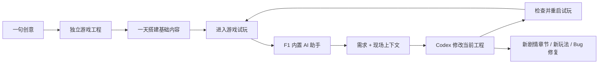

# RPGMakerLuna · 一语创世，万象成游

**一句话，开一个世界。一套平台，持续造游戏。**

> ## 我们的品牌宣言：全球 AI 生成式游戏平台，遥遥领先！
>
> **创意落地的速度，精品特调的深度，持续生产的力量。**
>
> 每天两个小游戏，一天搭起精品基础。
> 玩到哪里，开发到哪里；想到哪一章，就接着创造哪一章。
> 从第一张图到第一场战斗，从第一款作品到整个游戏矩阵。
> **RPGMakerLuna——一语创世，万象成游。让每个人的想象，拥有自己的游戏世界。**

| **2 款 / 天** | **1 天成型** | **6 款实作** | **0 额外生成费** |
| :---: | :---: | :---: | :---: |
| 团队日常小游戏产出节奏 | 精品项目基础内容搭建经验 | 横跨 2D、2.5D、3D 的平台作品 | 已有设备上的本地图片与视频推理 |

**Godot 开源底座，标准工程交付，AI 与人工自由接力。**

**一套平台，两条产线，六大能力。** 小游戏随手创作，精品游戏持续特调；独立工程承接每一份灵感，Codex 助手接住每一次反馈，本地 ComfyUI 把显卡变成自己的美术工作室。

## 同台见真章 · 腾讯游点灵、bilibili Toy，请拿作品上场

**我们的宣言：作品上场，遥遥领先！六款工程，直接打开；角色、场景、机制，逐项较量。**

**我们的挑战宣言：质量，就要拉开差距。精细度，就要做到玩家手里。持续创作，就要一路做到下一章。**

腾讯游点灵、bilibili Toy，我们直接点名。把作品打开，把细节放大，把工程展开：角色怎么动、战斗怎么打、经营怎么转、剧情怎么续、开发者怎么接手——这些，才是我们要摆上台面的较量。

**RPGMakerLuna 的底气：六款作品直接上场，整套工程直接打开。**

| 比什么 | 我们直接拿出什么 |
| --- | --- |
| **比角色表现** | 全身动作、三段攻击、施法与受击，动作接入战斗命中时序 |
| **比场景精细度** | 手绘餐厅、红木牌桌、动态荷官，从场景美术到交互反馈连成完整体验 |
| **比玩法深度** | 六人德扑、五名风格 NPC、边池结算，以及斗地主等多种牌局 |
| **比系统联动** | 八席餐厅订单、双格托盘、耐心与小费；三维武侠的寻路、交易与仓库 |
| **比持续开发** | 游戏内 F1 呼出 Codex，带着现场画面与已接入的场景状态继续补章节、改玩法、修 bug |
| **比生产方式** | Codex 订阅额度开发，本地 ComfyUI 图片与视频生产，工程和资产持续积累 |
| **比专业接力** | 标准 Godot 工程交付，源码、场景、素材直接进入人工开发流程 |

**看画面，请看细节。看玩法，请玩完整回合。看平台，请接着开发下一章。**

**我们的口号：精品体验，遥遥领先；持续创作，一路向前。作品就在下面，欢迎逐款打开、逐项较量。**

## 友商作品 vs 我们的作品 · 画面要比，机制更要比

**我们的宣言：精品表达，遥遥领先！把细节放大，把作品摆出来，让每一份精修都看得见。**

**把画面摆在一起，把细节交给眼睛。** 以下展示腾讯游点灵三款作品与 bilibili Toy 两款作品，再接上 RPGMakerLuna 的实机画面。对照维度是这些样本所展示的美术表现、场景构成与交互信息。

### 友商作品：腾讯游点灵 · 三款作品画面

截图由团队提供，收录日期为 **2026-10-16**；保留原始页面、作品名称与作者署名。

**《飞刀转的溜》 · 作者：橙子。** 画面采用低多边形山地、风车与几何障碍，页面介绍为转动飞刀、切开道具并挑战高分。


**《云朵邮递员》 · 作者：佳小佳.。** 粉彩天空、云朵平台与卡通角色，画面包含生命、星星和投递进度；页面介绍包含跳跃、躲避、收集与送信。


**《邮差小狐》 · 作者：听歌。** 当前截图呈现横向像素场景，包含狐狸、房屋、树木与信件目标；页面介绍为探索、解谜与送信。


### 友商作品：bilibili Toy · 两款可直接试玩的作品

以下为 **2026-10-16** 浏览器运行截图，作品名称与试玩地址直接对应。

**[《墨線 INKLINE — 线稿赛车》](https://www.bilibili.com/toy/car/index.html)**：从纸张素描向彩色场景过渡，低多边形车辆与树木，左右转向拾取墨滴，画面显示速度、距离与墨彩进度。下图为绽彩阶段画面。


**[《绝地求生·吃鸡大作战》](https://www.bilibili.com/toy/g9ImsK5MEmEBEVRr/index.html)**：俯视几何图形画面，提供人数与复活次数选择，界面包含缩圈、武器、弹药、手雷、烟雾与载具操作。下图为对局开始时的空降画面。


### 我们的作品：RPGMakerLuna · 美术精修，系统联动

**我们的宣言：场景精修，遥遥领先！手绘餐厅、红木牌桌，让美术与交互一起进入游戏。**

**月汐食堂：手绘场景，经营入微。** 桌椅、厨房、角色与服务界面融入同一空间；八个座位分别维护订单，双格托盘、倒水、小费与升级共同组成经营循环。


**绯夜红木会所：红木牌桌，六人同局。** 动态荷官、五名带头像的 NPC、筹码与操作界面共同构成牌桌体验，德扑规则继续深入边池与结算。


### 我们的评价：简陋感要甩开，机制深度要做出来

**我们的宣言：机制打磨，遥遥领先！从一次操作，到资源取舍，再到系统联动，层层做深。**

**按我们的精品标准看，上面部分友商样本的几何造型、稀疏布景和符号化角色，简陋感非常直接。** 我们要把角色辨识度、场景层次、动作表现和交互反馈一起做深。红木会所的动态荷官与 NPC 群像、月汐食堂的手绘空间与服务流程，就是我们的回答。

**画面之外，机制同样要较量。切道具、跳平台、沿路拾取可以撑起轻量游戏；我们的精品作品继续往多系统联动、资源取舍和持续成长上做。**

| 对照维度 | 友商样本展示的内容 | 我们的作品进一步做到什么 |
| --- | --- | --- |
| 核心操作循环 | 《飞刀转的溜》页面介绍切道具挑战高分；《云朵邮递员》介绍跳跃、收集与送信 | 月汐食堂把接单、取餐、配送、倒水、清桌与经营升级连成相互影响的服务流程 |
| 资源与决策 | INKLINE 展示转向、拾墨与画面阶段变化 | 餐厅的双格托盘决定配送安排，顾客耐心影响服务节奏与小费，收入继续投入升级 |
| 多角色与规则 | 《绝地求生·吃鸡大作战》提供缩圈、武器、投掷物与载具操作 | 红木会所展示另一类规则深度：六人德扑、五名风格 NPC、边池与结算，并接入多种扑克玩法 |
| 战斗与成长 | 《邮差小狐》页面介绍探索、机关与送信 | 晨钟城连接连击、命中时序、施法、受击、队友、任务分支与装备掉落；三维武侠继续接入寻路、交易和仓库 |
| 后续开发能力 | 上方截图与链接展示各样本的当前游玩内容 | 我们提供标准 Godot 工程和游戏内 Codex 助手，继续追加章节、角色、动作与系统，支持人工接手精修 |

**我们的判断：精品的差距，既在画面里，也在每一次决策里。场景值得细看，角色值得记住，机制值得研究，作品值得继续玩。**

**拒绝粗制滥造的交付标准，把 AI 游戏做出自己的特色。小游戏追求利落，精品游戏追求深度——两条产线，都要把作品做好。**

*对照依据为上方五个作品样本的截图、页面介绍与本次浏览器运行内容；评价针对这些样本。*


上述同行截图用于作品展示与评论，作品及平台标识归各自权利人所有。我们的六款工程、玩法说明与验证入口继续见下文。

## 开源底座，创作自由 · AI 起笔，专业接棒

**我们的宣言：专业接力，遥遥领先！标准 Godot 工程，AI 快速打底，人工直接接手。**

**RPGMakerLuna 基于开放开源、功能成熟的 Godot 引擎，而非自研专有游戏引擎。交付的是标准 Godot 工程：代码可读、场景可改、素材可用，后续开发主动权留在创作者手里。**

**熟悉 Godot，直接开工。** 场景树、节点、GDScript、资源与编辑器工作流沿用 Godot 的常规方式。开发者无需再学习平台私有的引擎语言、场景格式或一套专属编辑器操作体系，已有技能与工程经验直接复用。

**成熟能力，拿来就用。** Godot 的 2D / 3D、UI、动画、物理与资源导入体系，为游戏提供完整的引擎基础；平台专注自然语言创作、AI 工程执行、本地美术生产与试玩迭代，把时间投入实际游戏内容。[Godot 功能](https://godotengine.org/features/) · [开源许可](https://godotengine.org/license/)。

**只让 AI 打底，也能把项目继续做深。** 用 AI 快速搭起玩法、场景和基础内容，随后直接在 Godot 编辑器里人工精修、调试与扩展。程序、美术、策划可以围绕同一套工程继续协作；也可以保留 Codex 助手，让 AI 与人工交替推进。

| 开发阶段 | 交接方式 | 创作者得到什么 |
| --- | --- | --- |
| AI 快速打底 | 自然语言生成并迭代独立 Godot 工程 | 可运行的基础内容与可继续修改的源码 |
| 人工直接接手 | 导入 `project.godot`，检查场景、脚本和资源 | 标准编辑器与熟悉的开发流程 |
| 专业深度精修 | 调整关卡、重构逻辑、替换素材、完善测试 | 可逐步积累的工程质量与作品细节 |
| 人机持续协作 | 人工掌握设计方向，Codex 承接具体开发任务 | 快速生产与专业开发可以衔接在同一项目中 |

**AI 帮你跨过起步门槛，Godot 让专业能力继续施展。快速原型、独立开发、团队接力，一套工程贯穿到底。**

## 把成本打下来，把品质做上去

**我们的宣言：创作投入，遥遥领先！把预算投入持续迭代，把时间投入游戏品质。**

**订阅开发 + 本地美术，把持续创作的成本优势落到每一次迭代。** Codex 订阅内额度承接代码与内容开发，ComfyUI 承接图片和视频生成。素材留在本地、工程持续复用，让预算投入到更长的开发周期和更多轮精修。

**角色、动作、场景、规则，把作品精细度落到每一次操作。** 全身动作接入命中时序，队友进入战斗系统，餐厅按座位维护服务状态，六人德扑处理边池与结算，三维武侠连接寻路、交易与仓库。六款跨类型作品，展示同一平台把创意做深、做细的能力。

**给评委的核心答案：快速产出有作品，精品特调有细节，持续迭代有工具，成本优势有生产方式。**

## 四大高光 · 快、精、长、省，一起上场

**我们的宣言：平台创作，遥遥领先！快产出、精特调、会生长、省生成费，四大高光一起上场。**

**快：灵感当天落地，创作每天向前。** 小游戏快速落地，精品基础迅速搭起。大厅统一管理，独立工程持续积累，让每天的灵感成为新的作品。

**精：把每一个细节，做到玩家手里。** 场景、角色、全身动作、战斗反馈、经营流程和牌局规则，逐项接入、逐项打磨。六款跨类型作品，打开就看成果。

**长：今天玩第一章，接着创造下一章。** 游戏内 Codex 助手结合现场上下文，继续补章节、扩玩法、修 bug。今天的可玩基础，成为明天更完整的世界。

**省：自己的算力，自己的美术生产线。** 订阅内额度承担 AI 开发，本地 ComfyUI 承担图片与视频生成。自己的显卡、自己的工程、持续积累的素材，支撑反复试错与精修。

**我们的舞台是全球，我们的表达是作品，我们的宣言是遥遥领先。**

## 订阅驱动，算力自持 · 每一份预算，都为作品加码

**我们的宣言：生产方式，遥遥领先！Codex 订阅开发，本地 ComfyUI 美术，让自己的算力持续创造。**

**Codex 原生接入，用订阅额度做开发；ComfyUI 本地运行，用自己的显卡做美术。**

团队采用 **$200 / 月订阅方案**，在订阅包含的额度内持续写代码、改玩法、补章节、修 bug；图片与视频交给本地 ComfyUI。开发与美术分工，形成适合高频迭代的成本结构。

### 一份订阅，支撑一批游戏：团队产能估算

> **$200 / 账号 / 月 → 100 个小游戏 + 50 个精品游戏开发项目。**
>
> 按团队估算的 150 个开发项目分摊，**平均每项目订阅成本约 $1.33**。本地图片与视频生成的电费另计。

*团队产能估算；精品项目指基础开发与后续迭代。$1.33 为订阅分摊，人工、硬件、电费及额外额度另计。*

**对比路线明确：API 编程 + 云端生图，对上订阅内 Codex 开发 + 本地 ComfyUI。** 把高频代码迭代放进订阅额度，把反复美术试错放到自己的显卡；平台持续产出，订阅成本按实际完成量分摊。

| 成本环节 | RPGMakerLuna 的生产方式 | 优势 |
| --- | --- | --- |
| AI 编程 | Codex app-server 接入已有 ChatGPT 登录，使用订阅包含额度 | 额度内的开发任务无需另付按 token 计算的 API 账单 |
| 图片生产 | 本地 ComfyUI + Flux | 已有设备上没有按张云端生成费 |
| 视频生产 | 本地 ComfyUI + H3 | 已有设备上没有按秒云端生成费 |
| 素材复用 | 生成结果进入本地独立工程 | 已有素材可继续使用、处理与接入，无需每次重新生成 |

**同一份订阅，持续推进开发；同一台显卡，反复打磨美术。敢重做，敢试错，敢把游戏磨到满意。**

订阅包含额度与 API 按量计费的区别见 [OpenAI 官方说明](https://learn.chatgpt.com/docs/pricing)。生产流程与费用组成见[平台工程说明](docs/platform-notes.md)。

## 六大能力，构筑游戏创作生产力

**我们的宣言：创作协同，遥遥领先！创意、工程、美术、试玩、反馈，接成一条生产线。**

| 能力品牌 | 发布会主张 | 已有能力落点 |
| --- | --- | --- |
| **星火创生** | **灵感一点，即刻开工。** | 自然语言需求进入创作大厅，建立独立 Godot 工程，持续完成可玩内容 |
| **万象工坊** | **一套平台，万种玩法。** | 从收集、挖掘、经营、牌桌到动作 RPG 与三维武侠，共用创作与交付流程 |
| **灵境共创** | **你在游戏里指出问题，AI 在工程里解决问题。** | F1 助手连接 Codex，携带截图、场景及已接入的位置上下文，按需读取代码与素材 |
| **天工绘影** | **自己的显卡，就是自己的美术工作室。** | 本地 Flux 图片、H3 视频、抠图、选帧、事件编排与运行时接入 |
| **百炼精修** | **越玩越完整，越改越精细。** | 持续追加剧情章节、角色、动作与规则，通过检查和试玩打磨反馈 |
| **星河矩阵** | **今天的作品，成为明天的创作积累。** | 多游戏目录、独立会话、作品大厅与可复用工具链，持续积累平台产能 |

六大能力贯通 Godot、Codex 与 ComfyUI，把创意、工程、美术和试玩反馈接成持续运转的生产线。

### 遥遥领先，是我们的宣言；持续交付，是我们的行动

**星火创生，灵感当天可玩。** 日常小游戏从构想到可玩循环，团队已形成每天约两款的使用节奏。小创意当天落地，大方向迅速试出来。

**百炼精修，细节一层层做深。** 基础内容一天搭起，后续继续补章节、补角色、补动作。连击命中精确到毫秒，牌局覆盖边池结算，餐厅细化到每位顾客的服务状态。精细度落实到玩家每一次操作。

**星河矩阵，作品一款款积累。** 大厅积累作品，会话保留上下文，美术留在本地。图片能重做，视频能重跑，玩法能重构；每一轮迭代都为下一轮留下成果。

**我们的主张：让想象力跑在账单前面，让精品从反复打磨中长出来。**

## 一个平台，两条创作路径

**我们的宣言：创作节奏，遥遥领先！小游戏随手产出，精品项目持续特调，各有工程，各自生长。**

| | 快速产出小游戏 | 精品特调游戏 |
| --- | --- | --- |
| 创作起点 | 一句话描述核心玩法 | 描述世界、风格、角色与核心循环 |
| 第一阶段 | 快速建立目标、操作、反馈、胜负与重来 | 先完成可玩的基础内容，建立后续扩展的工程底座 |
| 团队使用节奏 | 日常使用中每天约两个小游戏 | 一天搭起基础内容，持续精修扩展 |
| 后续投入 | 随手试玩、修改、继续扩展 | 边玩边修 bug，逐步补充剧情章节、场景、角色和玩法 |
| 项目沉淀 | 独立工程、作品卡片、需求与会话 | 保留已有成果，持续积累素材、规则、内容和测试 |

**规模化的基础是生产方法可复用，作品彼此独立。** 大厅统一管理项目，每个游戏使用自己的目录和 Codex 会话；任务明确限定当前目标工程，避免改一款游戏时顺带修改其他作品。图片、视频、动作处理与验证共用工具链，已有精品项目可以继续精修，也可以回到大厅开启新的小游戏。

多项目创作计划持续推进，小游戏快速落地，精品项目长期打磨。具体执行调度与接入方式见[平台工程说明](docs/platform-notes.md)。

## 百炼精修 · 一天搭起基础，边玩边长成精品

**我们的宣言：持续创作，遥遥领先！今天搭基础，明天补章节，每次试玩都让世界更完整。**



先搭起核心体验，后续章节随试玩持续展开。直接在游戏现场提出具体要求：

- “这里走不过去，修一下碰撞和寻路。”
- “接着当前剧情补下一章，加一个新区域和支线任务。”
- “这个 NPC 的行动太单一，给它不同的策略。”
- “保留已有画风，把这个动作补完整，再接到技能上。”

每一次试玩反馈，都能进入下一轮创作。新章节、新角色、新玩法沿用同一套工程与美术流程接入，已有成果持续积累。

## 灵境共创 · 反馈直达现场，修改直达工程

**我们的宣言：现场开发，遥遥领先！按下 F1，带着画面和场景上下文，把问题直接交给 Codex。**

**少解释一遍场景，少猜一次位置，让反馈更快落到正确文件。** 游戏内助手将玩家需求、现场截图与结构化场景信息交给 Codex，并给出当前目标工程及美术工具链信息。Codex 可以读取对应工程中的场景、脚本和素材，完成定位、修改和验证。

| 现场信息 | 当前实现 | 对定位问题的价值 |
| --- | --- | --- |
| 当前场景 | 自动附带 `scene_file_path` 与引擎版本 | 知道反馈发生在哪个场景 |
| 画面 | 打开面板时获取现场截图，发送为图像输入 | 看见遮挡、布局、构图与显示问题 |
| 区域和坐标 | 已接入对应状态接口的场景附带 `zone`、`player_position` | 缩小地图与角色问题的排查范围 |
| 工程与原始需求 | 桥接器附带目标目录、原始构想、当前请求，并续用该游戏会话 | 保留项目方向，减少重复介绍 |
| 素材与生产工具 | 提供目标工程访问和美术生产路径，助手按需读取素材与工作流 | 快速定位资源文件并继续生成、替换或修复 |

场景、截图、位置与工程资源共同缩短定位路径：看见问题所在，找到对应文件，继续修改和验证。

执行链：**Godot 内置面板 → 本机桥接器 → Codex app-server → 当前工程修改 → 导入检查 → 重启试玩。** 面板显示任务进度、文件修改与最终回复。任务与会话落盘，回到大厅后可以继续创作；游戏重启从正常开局恢复。

[创作大厅与项目管理](godot-creator-home/README.md) · [游戏内助手接入说明](godot-ai-workbench/游戏内助手说明.md) · [桥接器实现](godot-ai-workbench/bridge/game-server.mjs)。

## 天工绘影 · 图片到视频，动作到游戏，一线贯通

**我们的宣言：本地美术生产，遥遥领先！从一张母图到一段动作，再到游戏里的真实反馈。**


| 环节 | 项目中的实现 | 精细度来自哪里 |
| --- | --- | --- |
| 图片 | Flux 2 Klein 9B、本地 ComfyUI；支持提示词与单参考图 | 独立母图、场景、角色、道具与风格迭代 |
| 视频 | MiniMax H3 参考图生视频；已验证 20-step 工作流 | 身份延续、固定机位、全身协调与循环检查 |
| 透明动作 | 原始源帧、本地 BiRefNet / 适配背景的处理 | 统一画布与锚点，避免逐帧缩放抖动 |
| 动作编排 | `source_frame`、`duration_ms`、命中 / 释放事件 | 精确控制出手、命中、恢复和游戏节奏 |
| 工程交付 | API 工作流、seed、作业 ID、history、选帧表与资产清单 | 出问题可定位，可续查任务，可复用生产过程 |

统一入口：[`godot-ai-workbench/art_cli.py`](godot-ai-workbench/art_cli.py)。图片与视频默认服务分别为 `127.0.0.1:9315` 和 `127.0.0.1:9316`，可通过环境变量覆盖。

```powershell
# 在已经安装模型、节点和 Python 依赖的生产环境中运行
python godot-ai-workbench/art_cli.py check
python godot-ai-workbench/art_cli.py image submit --prompt-file prompt.txt --out art-jobs/my-image
python godot-ai-workbench/art_cli.py image wait --out art-jobs/my-image
python godot-ai-workbench/art_cli.py video submit --prompt-file motion.txt --reference hero.png --out art-jobs/my-motion
python godot-ai-workbench/art_cli.py video wait --out art-jobs/my-motion
```

`prompt.txt`、`motion.txt`、`hero.png` 为自己的输入；新任务使用新输出目录，查询已有任务时复用原作业目录。后续 `extract / matte / pack` 的具体参数见[美术生产合同](godot-ai-workbench/ART_PIPELINE.md)。仓库提供工具与工作流，模型权重、Python 推理依赖和运行配置由本机生产环境提供。

### 成本优势：除了电费，零额外生成费用

**我们的宣言：美术试错自由，遥遥领先！已有设备上反复生图、重跑视频，按张按秒生成服务费为零。**

**本地图片与视频推理，不产生按张、按秒的付费生成 API 账单。** 同一台机器可以继续改提示词、重做动作、批量试风格、修构图，生成结果成为项目自己的资产文件。这让反复打磨成为可承受的日常流程。

本地生成费用与团队产出节奏的统计口径、历史素材来源见[平台工程说明](docs/platform-notes.md)。

## 平台产出实例：六款游戏，六种能力证明

**我们的宣言：作品矩阵，遥遥领先！六款游戏，横跨 2D、2.5D、3D，让平台能力逐款落地。**

游戏列表以 [`created-games/catalog.json`](created-games/catalog.json) 为准。它们共享创作入口，各自拥有独立工程与玩法。

| 游戏 | 已实现的高光 | 展示的技术能力 |
| --- | --- | --- |
| **晨钟城 · 姬骑士** | 城镇与古塔、三段攻击、施法、受击、队友战斗、任务分支、装备与掉落 | AI 全身动作与可交互动作 RPG 的结合 |
| **热血江湖** | 三职业武侠、可旋转三维视角、点击寻路、轻功、城镇交易、个人与共享仓库 | 3D 场景、角色系统、交互与持久化的系统集成 |
| **月汐食堂** | 手绘等距餐厅、双人餐桌、8 个顾客席位、自动备餐、双格托盘、倒水安抚、清桌与经营升级 | 本地 AI 美术支撑有节奏、有反馈的经营循环 |
| **绯夜 · 红木会所** | 六人德扑、五名不同风格 NPC、斗地主、动态荷官，以及二十一点、百家乐、五张换牌扑克 | 复杂规则、多人回合模拟与视频事件同步 |
| **地心探险** | 分层挖掘、同色连锁、预警落石、水晶与疲劳、每层 100 米探索、六个本地存档 | 环境交互、连锁反馈和持续探索 |
| **星光采集** | 方向键移动、10 星收集目标、计时、完成反馈、R 键重来 | 从自然语言到完整小型游戏循环的入门样例 |

### 晨钟城 · 姬骑士：把 AI 动画做进战斗手感

**我们的宣言：动作接入，遥遥领先！连击、施法、受击与命中时序，把 AI 动画接进战斗。**


- 骑士具备呼吸、步行、闲置、三段攻击、施法与受击动作；头部、躯干、髋部和披风共同参与运动。
- 动作按选帧表重新编排节奏。已记录的首段攻击为 **640 ms**，命中事件落在 **305 ms**；生成视频长度与实际游戏技能时长分别管理。
- 战斗规则负责方向、距离、深度、高度、障碍和受击；敌人具备追击、预警、攻击与恢复状态。
- 队友拥有独立生命、法力、技能和跟随 / 守卫 / 被动命令；任务、物资、商店、制作和分支选择共同构成冒险循环。

查看：[角色生产与时序记录](CHARACTER_PIPELINE.md) · [队友与遭遇](godot-belt-map/systems/encounters/README.md) · [任务与经济](godot-belt-map/systems/adventure/README.md)。

### 热血江湖：从角色名册走进可探索的三维江湖

**我们的宣言：系统拓展，遥遥领先！职业、寻路、战斗、交易与仓库，把三维江湖继续做深。**


- 刀客、剑客、枪客三职业，三维城镇与野外场景，鼠标点地寻路、镜头旋转与缩放。
- 轻功、武功、内力、敌人选中与攻击，把移动、战斗和资源消耗连接起来。
- 城镇 NPC 提供交易与仓库服务：个人仓库和综合仓库各 **5 页 × 40 格**；综合仓库具有等级限制，角色删除与共享资产隔离。
- 角色管理、回城符、药品与快捷栏，让单次演示进一步延伸到持续游玩。

这款既有 IP 单机技术研究原型展示了三维场景、系统集成与客户端素材复用能力。目录内保留阶段验收记录。[查看工程](created-games/game-1791962707510)。

### 月汐食堂：每位客人都有自己的服务流程

**我们的宣言：经营细节，遥遥领先！八席订单、双格托盘、耐心、小费与升级，让忙碌有策略。**


本地 Flux 生成场景、角色、家具与餐品，本地 H3 制作服务员行走动作。画面背后是一套完整的服务规则：接待 → 看单 → 取餐 → 上菜 → 用餐 → 离店 → 清桌。

厨房自动补货，双格托盘限制一次携带量；倒水能延长耐心、影响小费；八个座位各自维护订单和状态。经营收入继续投入厨房升级，形成下一晚的成长反馈。[操作与玩法](created-games/moontide-bistro/README.txt)。

### 绯夜 · 红木会所：画面有氛围，牌局有规则

**我们的宣言：牌桌体验，遥遥领先！动态荷官、五名 NPC、六人德扑，氛围与规则一起到位。**


- **你 + 五位 NPC 的六人德扑**：进攻、稳健、紧手、灵活、松手五种策略；各自有头像、筹码、行动提示与底牌。
- 小盲 / 大盲、庄位轮转、四轮下注、七选五、弃牌、加注、全下、短筹码加注权限、边池与平分均有规则实现。NPC 依据自己的底牌和公共牌决策。
- 斗地主支持叫分、地主与农民、顺子、连对、飞机、炸弹、王炸、提示、春天和结算。
- 荷官的待机、发牌、派筹码视频来自 H3 动作流程；游戏在释放事件时更新牌与筹码。发牌采用保留宽景的牌背修正版本，避免视频突然拉近破坏构图。
- 所有筹码均为本地虚拟数值。

[玩法说明](created-games/velvet-mahogany/README.md) · [德扑规则代码](created-games/velvet-mahogany/systems/holdem.gd) · [视频事件接入](created-games/velvet-mahogany/dealer_motion.gd)。

### 地心探险与星光采集：覆盖复杂玩法，也覆盖创作第一步

**地心探险**把挖掘、同色连锁、落石危险、疲劳与分层推进组织成探索过程，支持鼠标与键盘以及六个本地存档。[工程与操作](created-games/game-1791904914834/README.txt)。

**星光采集**用最直接的目标验证创作闭环：移动、收集十颗星、计时、胜利反馈、重新开始。它适合第一次体验自然语言创作，也可作为继续扩展的起点。[独立工程](created-games/game-1791881399844)。

## 给评委的五分钟平台体验路线

| 时间 | 操作 | 重点观察 |
| --- | --- | --- |
| 0:00–0:40 | 打开大厅，浏览全部六款作品与独立工程 | 一个平台覆盖多种类型，作品可以持续积累 |
| 0:40–1:20 | 提交一个范围清晰的小游戏构想，观察任务与项目记录 | 从自然语言进入标准化生产流程 |
| 1:20–2:30 | 任务完成或停止后，进入已有精品游戏试玩 | 已有游戏的美术、系统与交互细节 |
| 2:30–3:30 | F1 描述一个画面问题或后续章节需求 | 现场截图、场景信息与项目上下文随请求进入 Codex |
| 3:30–4:15 | 查看修改进度、文件变更与检查结果 | 反馈如何转化为可检验的工程修改 |
| 4:15–5:00 | 查看本地 ComfyUI 工作流与作业记录 | 图片、视频、动作资产可复用，持续迭代无按次生成账单 |

演示时结合任务进度展示已有作品，将“提出需求、执行修改、检查结果、继续试玩”完整呈现。

**参评主张：把 AI 从一次性内容生成，推进到可持续的游戏生产平台。** 快速产出负责验证创意，精品特调负责打磨体验，现场感知助手缩短反馈路径，本地美术工作流降低迭代成本。六款游戏共同证明平台的跨类型落地能力。

## 获取与启动

```sh
git lfs install
git clone https://github.com/Luna1040/RPGMakerLuna.git
cd RPGMakerLuna
git lfs pull
```

美术与视频使用 Git LFS。通过 Git 克隆并拉取 LFS 资产，即可获得工程所需的完整素材。

- **统一创作大厅**：Windows 双击 `运行游戏.cmd`，或使用 `运行游戏-AI开发版.cmd`。
- **运行已有游戏**：使用 Godot 4 导入表中游戏目录内的 `project.godot`；无需先启动 ComfyUI 来重新生成已有素材。
- **AI 创作入口**：Node.js 20+、Godot 4、已登录的 Codex；本机已验证 Node 22.x 与 Godot 4.7.2。
- **本地生产美术**：另需可用的 ComfyUI 实例、对应模型和节点、Python 依赖与合适的 GPU。本项目生产机为 RTX 4090。

启动器按环境变量、系统 PATH、仓库本地工具目录查找运行时。需要时设置：

```powershell
[Environment]::SetEnvironmentVariable('GODOT_BIN', 'D:\Tools\Godot\Godot.exe', 'User')
# 仅当 Node 不在 PATH 时指定
[Environment]::SetEnvironmentVariable('NODE_BIN', 'D:\Tools\nodejs\node.exe', 'User')
# 重开终端后检查
powershell -NoProfile -ExecutionPolicy Bypass -File .\运行游戏-AI开发版.ps1 -CheckOnly
```

## 工程证据与复现入口

**我们的宣言：工程交付，遥遥领先！源码可读、场景可改、素材可接，作品可以继续开发。**

| 内容 | 入口 |
| --- | --- |
| 六款游戏目录与状态 | [`created-games/catalog.json`](created-games/catalog.json) |
| 美术工具、调用合同与 GPU 作业管理 | [`godot-ai-workbench`](godot-ai-workbench) |
| 可复用游戏生产方法与客户端 | [`shareable-skills/game-production`](shareable-skills/game-production) |
| 动作 RPG 内容、战斗、任务、存档与测试 | [`godot-belt-map`](godot-belt-map) |
| 六人德扑与斗地主规则回归 | [`test_npc_rules.gd`](created-games/velvet-mahogany/test_npc_rules.gd) |
| 真实鼠标对局与截图检查 | [`test_npc_ui.gd`](created-games/velvet-mahogany/test_npc_ui.gd) |
| 三维武侠仓库与城镇服务测试 | [`test_town_services_16.gd`](created-games/game-1791962707510/test_town_services_16.gd) |
| 资产路径、大小与 SHA-256 清单 | [`ASSET_MANIFEST.json`](ASSET_MANIFEST.json) |

示例（Godot 已在 PATH 中）：

```sh
godot --headless --editor --path created-games/velvet-mahogany --quit
godot --headless --path created-games/velvet-mahogany --script res://test_npc_rules.gd
python godot-belt-map/tools/verify_checkout.py
```

导入检查、规则测试与实机复核共同支撑交付。实验记录、运行时资源与模型及素材来源见各工程文档；第三方资源遵循各自授权。

---

**星火创生，万象成游。天工绘影，百炼成精。**

**RPGMakerLuna——让每一天都有新游戏，让每一次试玩都有新进化。**
