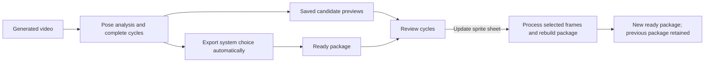

# Cycle candidate review

Status: implemented. This document records the accepted interaction and
persistence contract. See [Web verification](web-verification.md) for automated
coverage; live model generation is a separate acceptance step.

## Recommended experience

Keep generation and the first export automatic. Add **Review cycles (N)** to
each eligible animation block in section 2, with the same action available
beside the final animation preview. Both open one shared, spacious comparison
dialog. The initial export uses the system's choice; users can choose another
cycle and select **Update sprite sheet** to create a revised package.

This preserves unattended rendering and lets the user compare against a
finished result. There is no mandatory approval step between extraction and
export. Changing a cycle reuses the generated videos and pose analysis.
Background removal may still need to run for newly selected frames.

## What a candidate means

Use all complete temporal cycles found within the generated clip at the
detector's chosen period. Do not present the numerical period-fit hypotheses
from `period_candidates.json` as separate animation options. Those are
alternative estimates of cadence, not exported cycles.

The current detector fits named ankle motion, predicts cycle boundaries, and
selects the lower temporal median complete cycle. It does **not** rank each
cycle's visual quality. Preserve that policy initially and label its choice
**System pick**, with secondary explanation **Middle complete cycle**. Avoid
quality scores or claims that this is visually the best candidate.

Eligibility follows the captured animation definition's
`selection.method == "cycle"`, currently Run, Walk, and Crouch walk. A looping
WebP or `conceptual_loop: true` alone is insufficient: Idle uses uniform
sampling, so it has no detected cycle alternatives under the current system.
New catalog animations using cycle selection inherit review automatically.

Each candidate uses the requested exported frame count, the same phase
convention, source timestamps, and playback timing as its eventual export.
One selection applies to all four directions to retain synchronization.

## Interaction details

1. An animation block shows **Finding cycles…** while its analysis is active,
   then **Review cycles (N)** when a complete candidate manifest is published.
   Preserve the existing generation spinner and single-owner raw previews.
   Candidate review belongs to the selected animation output; shared upstream
   dependencies do not produce duplicate review galleries.
2. Opening review selects the cycle used by the displayed package. On the first
   render that is the system pick. The System pick badge remains visible after
   a user override, and **Use system pick** restores it.
3. Show numbered cards in chronological order. Each has a looping preview,
   source time range, duration, frame count, and a native radio selection.
   Selection and enlargement are separate controls: clicking a radio selects;
   **Enlarge** opens the existing media lightbox without changing the choice.
4. Previews show the sampled, unprocessed four-view frames, including their
   original background. Label this once above the gallery. This allows review
   without running background removal on every candidate and avoids assuming
   that final-package crop boundaries fit alternate frames. An enlarged
   four-view preview supplies enough space to inspect the other directions.
5. Visible previews loop at the same phase using one playback clock. Offer
   **Pause all**, frame stepping, and speed control. Honor reduced motion;
   explicit Play remains available. Lazy-load previews, pause hidden cards,
   and page large galleries without omitting candidates.
6. Allow switching between eligible animations inside the dialog and stage one
   choice per action. Show a small change summary and one **Update sprite sheet**
   button for the full selection. The button is disabled when nothing changed.
   Closing the dialog does not submit work; retain its draft per job and
   analysis identity so reopening or refreshing does not lose valid choices.
7. Candidates may be browsed as analysis completes, but revision submission is
   disabled while the source job is still working. Explain that the first
   export continues automatically. After it ends, applying choices queues one
   revision through the existing scheduler and opens the activity modal.
8. Keep existing downloads available while updating. On success, show the new
   sheet and animations, with access to the previous render. On failure, keep
   the prior package and show the underlying error. Candidate selection is not
   evidence that sprite splitting or generated art will be valid.

With one complete cycle, show **Only one complete cycle found** and allow
preview without an unnecessary selection action. With no complete cycle, show
the actual extraction error; do not invent a candidate or silently change the
period. Manual trimming, alternative cadence models, and visual-quality
ranking are later work.

## Required pipeline changes

The previous implementation coupled discovery and chosen-frame export in
`diagnose_cycle.analyze`. `_worker` moves only the chosen sequence into
`frames/`. Selected-action packaging performs analysis inside a temporary
directory that is deleted on completion or failure. A UI-only change therefore
cannot provide durable alternatives or reliably reuse analysis.

Split the pipeline into explicit reusable operations:

- Analyze an immutable source video and publish complete-cycle metadata.
- Sample any valid candidate at a requested frame count using the existing
  nearest-frame/timestamp rules, without repeating SDPose.
- Build previews from those exact sampled frames using local media processing.
- Resolve selected candidates into the packer's frame records and timing.
- Remove backgrounds where needed and publish the complete package atomically.

The default path must produce the same lower-median cycle as today. Retain
compatibility for consumers of `six_frame_cycle` despite that legacy name;
introduce versioned candidate metadata alongside it. Persist analysis and
candidate assets outside disposable packaging directories, including when a
later splitter step fails.

Changing one action can change the combined foreground mask, shared cut
positions, cell size, centering, and origin of the sheet. Rebuild the whole
package layout and dependent exports from all selected frames. Do not splice
one animation's columns into an old sheet and assume the old layout remains
valid.

## Identity, storage, and reuse

Add a workspace-managed analysis cache with immutable manifests and validated
artifact paths. Separate these identities:

| Identity | Inputs that determine it |
| --- | --- |
| Pose analysis | Source video digest, crop, model identity/settings, extraction version |
| Cycle analysis | Pose analysis identity, period bounds, identity checks, algorithm version |
| Candidate | Cycle analysis identity and exact complete-cycle interval/ordinal |
| Sampled frames and preview | Candidate ID, exported frame count, sampling version, preview encoding |
| Background mask | Source frame digest, background-removal model/settings, processing version |
| Package | Exact generation revisions, candidate IDs, frame counts, existing output settings and processing versions |

Candidate IDs must not be derived from display labels or mutable file paths.
Persist frame IDs, PTS/time base, desired sample timestamps, actual sample
timestamps, period, and interval bounds. Preserve the half-open cycle sampling
rule so the loop endpoint is not duplicated. Keep every complete candidate
listed; deduplicate stored frame assets rather than removing review options.

A revision pins the original source, resolved seed, config and definition
snapshots, and exact generation revision IDs. The current packer reads active
stage revisions; revision execution needs explicit pinned inputs instead.
Never substitute a newer workspace artifact just because it has the same
action name. Include choices in both request idempotency and package cache
identity.

The revision worker must not submit video generation. Missing generation or
analysis artifacts produce an explicit unavailable/reanalysis state. ComfyUI
work, including explicitly requested reanalysis or missing masks, uses the
existing durable submission journal and activity modal. Cache masked frames
to avoid repeating background removal for unchanged selections; cached model
results must remain subject to exact identity checks.

Keep candidate artifacts under workspace ownership and account for their
storage. Workspace deletion removes them using the existing inactive-work
rules. GET routes only read published manifests/assets; they never start
decoding, model work, or jobs. Build previews in worker tasks with bounded CPU
and memory, decoding shared source frames once where possible.

## API and job contract

The web integration adds:

- `GET /api/jobs/{id}/cycles`: per-action availability, analysis ID, candidate
  IDs and intervals, system pick, choice used by this result, frame count, and
  opaque preview URLs. Return only valid complete candidates; retain useful
  diagnostics separately from the main gallery.
- `POST /api/jobs/{id}/cycle-revisions`: accept a complete selection map of
  action to analysis/candidate IDs, plus the base package when one exists.
  Require the existing idempotency header. Validate selections against the
  job's pinned artifacts and cycle-selection policies before enqueueing.
- `POST /api/jobs/{id}/cycle-analysis`: explicitly analyze retained video for
  an older render. Compatible saved pose evidence can be reused.
- `GET /api/cycle-assets/{id}`: serve registered sampled frames through opaque,
  durable asset identities.
- Existing artifact serving, job progress, activity, stop/resume, package, and
  download endpoints handle previews and the resulting revision.

Represent refinement as a new job kind with `parent_job_id`, exact source
references, and immutable cycle selections. Reuse normal queued, extracting,
removing-backgrounds, packaging, ready, stopped, failed, and recovery states.
No `awaiting_user` job state is needed for the recommended automatic-first
flow; viewing the gallery never occupies the worker or GPU.

Record `system_candidate_id`, `selected_candidate_id`, and selection origin
(`automatic` or `user`) in the final manifest. Preserve
`quality_evaluated: false`: choosing a preferred cycle does not certify the
whole generated package.

Old successful packages may provide reusable `raw_pose.json` and timing
evidence, which can be imported after source/hash validation. Where evidence
was deleted or is incompatible, offer **Analyze saved video for cycles** with
the expected ComfyUI work explained. Do not launch it merely by opening an old
render. Failed packaging jobs with retained new-format analysis remain
reviewable even when there is no published base package.

## Implementation order and acceptance

1. Extract pure candidate discovery/sampling and add durable analysis storage.
   Verify unchanged automatic selection, complete-interval filtering, VFR frame
   mapping, candidate identity, frame-count changes, and all-direction timing.
2. Add exact selected-frame inputs, mask reuse, and immutable revision jobs.
   Verify that selecting another candidate cannot trigger generation, silently
   change source revisions, reuse an incompatible package, or damage an older
   package. Exercise stop/restart and ambiguous postprocess recovery.
3. Add the read-only cycle API and revision submission route with artifact
   validation, idempotency, and old-job availability behavior. Verify that GETs
   have no inference side effects and invalid candidate IDs cannot reach files.
4. Build a shared cycle chooser using `DialogShell`, `Choice`, `Button`,
   `BusySpinner`, and the current theme contracts. Extract a reusable sampled
   frame player from the existing Results preview where appropriate; register
   the chooser/player and add specimens alongside their implementation.
5. Browser coverage: preselected system pick; persisted override; every
   candidate reachable; radio selection separate from lightbox; synchronized
   playback and reduced motion; draft preservation; one update submission;
   previous downloads retained; accurate errors and refreshed result preview.

Use recorded fixtures for verification. Any live model run is a separate,
explicitly scoped acceptance step. Opening an existing render does not modify
its artifacts or start analysis; a user must request analysis or a revision.
