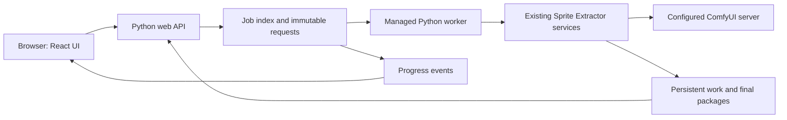

# Sprite Extractor web GUI implementation plan

Status: implemented and verified on 2026-09-07. All six delivery phases are
complete. Final acceptance passed 118 Python tests and 8 browser tests, including
the compiled UI served by the Python backend under a URL prefix. An isolated
subproject copy also built and served its installed wheel without the parent.
Layout decision: approved — concept A setup with concept C result previews.

The implementation lives in `web/` and `src/sprite_extractor/web/`, with shared
execution contracts in `application.py`, `runtime_config.py`,
`execution_lock.py`, `execution_hooks.py`, and `submission_journal.py`.
See the [user guide](web-user-guide.md), [deployment instructions](web-deployment.md),
[API contract](web-api.md), and [verification record](web-verification.md).

## Goal and scope

Build a browser-based interface for Sprite Extractor. A web server hosts the UI,
accepts images, runs the existing Python pipeline against ComfyUI, stores work,
and serves downloads. A user can access it from another computer's browser;
generation runs on the configured server, not in the browser.

Match the parent Wayfarer Forge editor's theme and control behavior while keeping
Sprite Extractor independently buildable and deployable. The parent application,
its source checkout, its Node dependencies, and its desktop runtime must not be
required by this web application.

The first release includes:

- Drag-and-drop image upload, with an equivalent Choose image button.
- Render settings, animation selection, and automatic dependency generation.
- Durable progress and access to recent renders after refreshing the browser.
- Downloads of the final sheet, metadata, individual animations, and a ZIP.
- Form-based editing and saving of the server's `config.yaml` settings.
- Reuse of compatible generated artifacts when changing an output selection.

Creating new animation types by writing prompts is a later release. Keep the
catalog/API extensible now, but do not add a disabled animation-authoring page,
prompt editor, graph editor, or animation-creation wizard in this release.
Desktop packaging, NW.js/Electron, installable PWA behavior, game-editor
integration, multi-user accounts, and direct-video/monolithic workflow editors
are also outside this release. Existing CLI modes remain supported.

## Existing implementation to build on

| Existing surface | GUI use |
| --- | --- |
| `animation_definitions.py` | Discover actions, policies, poses, defaults, and typed dependencies from the catalog |
| `workflow_templates.py` | Validate and render the two existing generation templates |
| `definition_runtime.py` | Plan cached work, generate revisions, recover submissions, and package selected outputs |
| `comfy_workflow.py` / `comfy_postprocess.py` | Resolve configuration, communicate with ComfyUI, analyze poses, and remove backgrounds |
| `character_animations.py` | Existing shared sampling and atomic sheet/WebP packaging |
| `staged-generation-state.json` and package manifests | Execution evidence, reusable artifacts, and downloadable deliverables |

The GUI should call a shared Python application service around these modules.
It must not recreate the DAG in TypeScript, duplicate sampling logic, parse CLI
console text for progress, or build ComfyUI graphs in the browser.

The current runtime has important constraints to expose accurately:

- One output tree retains an exact source-image identity and a resolved seed.
  Changing the source or fixed seed requires a different generation set.
- Changing selected actions or exported frame counts can reuse generation.
- Generation completion and final package completion are different states.
- A recorded submission or a provisional process status is not success.
- Unknown submission outcomes are recovered by their existing IDs, never
  treated as permission to submit another prompt.
- The image workflow currently packages four directions together. Do not offer
  a direction-count option that the engine cannot honor.

See [architecture.md](architecture.md), [configuration.md](configuration.md),
[output-format.md](output-format.md), and
[animation-authoring.md](animation-authoring.md) for the underlying contracts.

## User experience

### Selected layout

See the [generated layout concepts and prompt](design/web-gui-layout-exploration.md)
for three browser layouts in the parent editor's Solarized Dark theme.
Use concept A's single-page setup, with concept C's larger sheet and animation
preview in the completed-results area. The user approved this combination.
Keep concept B only as exploration history; its guided steps are outside the
selected design. Borrow C's preview controls within the results section while
retaining A's setup layout.
The functional requirements below take precedence over illustrative mockup text
and sprite-sheet arrangements.

### Navigation and main flow

Use three destinations: **Create sprites**, **Recent renders**, and **Settings**.
Keep the ordinary workflow on one page rather than spreading it across a modal
wizard. The page has a main column for the image and animation choices, a render
settings panel, and one prominent Generate sprites button.

```text
Sprite Extractor                         Recent renders   Settings

Create sprites
┌─────────────────────────────────┐  ┌──────────────────────────┐
│ 1. Drop an image                │  │ Render settings          │
│    or Choose image              │  │ Sprite size              │
│    [uploaded image + Replace]   │  │ Prompt style             │
│                                 │  │ Seed                     │
│ 2. Choose animations            │  │ Advanced settings ▸      │
│    Select all / Clear           │  │                          │
│    ☑ Idle          4 frames     │  │ 6 animations             │
│    ☑ Run           8 frames     │  │ 37 frames per direction  │
│    …                            │  │ Dependencies included    │
│    Automatic dependencies ▸     │  │                          │
└─────────────────────────────────┘  │ [Generate sprites]       │
                                     └──────────────────────────┘

Progress or results appear below, with a link to the saved render.
```

On wide screens, keep the source upload and animation checklist in the main
column, with render settings, selection summary, and the primary action in a
right-hand panel. Keep that panel visible while scrolling where viewport height
allows, without hiding controls. The completed-results section spans the page
below both setup columns so the sheet and animation previews have ample space.
Keep setup values available for adjustments after a render completes.

These numbers illustrate the portable defaults, not hard-coded UI assumptions.
Compute summaries from the selected catalog entries and effective settings.
Use a stacked layout on smaller screens; keep settings and the primary action
reachable without horizontal scrolling or a fixed desktop-size requirement.

### Upload

Accept one character image per workspace in this release. Make the entire drop
area a clear drop target and retain a keyboard-accessible native file chooser.
Dragging a file over the page must not navigate the browser away.

Show upload progress, filename, dimensions, a bounded image preview, and Replace
image. Validate the actual decoded format and dimensions on the server, in
addition to browser hints. Reject unsupported, corrupt, empty, or oversized
files with an inline message that leaves the rest of the draft intact. Start
with deployment-configurable limits of 20 MiB and 40 million decoded pixels;
enforce request limits while streaming, before allocating a full image.

Preserve the original uploaded bytes and their content hash in a stable
server-side path. Serve a separate thumbnail for the browser. Replacing an image
creates a new workspace/source identity and preserves previous results.
Do not require users to enter an output directory or understand server paths.

### Animation selection

Load choices from the backend catalog. Display readable names, a short
description where available, a checkbox, and the exported frame count. Add
optional display metadata to the catalog schema without making it part of the
generation identity; fall back to a readable identifier when metadata is absent.

Select all built-in actions initially. Provide Select all and Clear controls.
Frame-count controls are enabled for selected animations; single-frame policies
display “1 frame · still pose” without an editable multi-frame count. Do not
promise an animated WebP for a still output such as crouch.

Dependencies are automatic. A walk-only request can say “Also generates the
reference poses needed for Walk.” Expandable details show the required stages
and reuse decisions, but prerequisites are not extra checkboxes the user must
manage. Only selected outputs enter the final package.

Changing a checkbox or count refreshes a debounced, read-only plan. Show cached,
new, and dependency-pending work in plain language. Do not promise a cache hit
for a dependent stage whose required image has not yet been generated.

### Render settings

Use visible labels above inputs, explicit units, inline validation, and values
derived from the effective backend configuration. Explain the distinction
between generation resolution and final sprite size.

| Placement | Control | Behavior |
| --- | --- | --- |
| Main settings | Sprite size | Target sprite height and square WebP size; portable default 256 px; sheet cells may expand to fit wider poses |
| Main settings | Prompt style | Existing neutral/feminine variants, with human-readable help |
| Main settings | Seed | Random or Fixed; show the resolved seed after submission |
| Animation row | Exported frames | Existing policy validation; changes packaging, not video duration |
| Advanced | Generation width/height | Per-view dimensions; show derived four-view image size |
| Advanced | Top padding | Percentage, with the resulting generation height shown |
| Advanced | Split method | Existing Blobs/Quarters choices; describe when to use each |
| Animation details | Video duration | Optional per-render override of the selected action's catalog duration |
| Animation details | FPS | Optional per-render override; show effective aligned video frame count |

Duration/FPS overrides update a validated copy of the stage definition for that
render. Preserve its prompts, inputs, and outputs, archive the effective copy,
and let the existing renderer own frame alignment. Do not save these changes to
the built-in catalog or `config.yaml`; they belong to animation definitions.
Intermediate stages retain their catalog defaults in this UI release.

Keep sampler internals and model paths out of the ordinary creation flow. Show
the server's connection status near the primary action, with a link to Settings
when it needs attention. An unavailable server must not discard uploaded images
or edited settings.

Transport fixed seeds as decimal strings across JSON/TypeScript boundaries:
the supported 64-bit range exceeds JavaScript's safe integer range. Python
performs the authoritative conversion and range check.

### Starting, progress, and recovery

Generate sprites creates a persisted job and returns immediately with its ID.
Disable duplicate submission while the request is pending and use server-side
idempotency to cover double clicks and lost HTTP responses.

The progress view distinguishes Preparing, Generating, Extracting frames,
Removing backgrounds, Packaging, and Ready. Show the current action/stage,
completed stage count, elapsed time, and cached work. Use indeterminate progress
where the backend has no measurement; do not fabricate GPU percentages or ETAs.
Technical logs and prompt IDs belong in expandable details.

Refreshing, closing the tab, or losing the browser connection does not cancel
generation. Reopening its URL reconnects to the existing job. A connection-lost
banner must not look like a failed render and must not trigger resubmission.

Queued jobs can be canceled immediately. For an active job, use **Stop after
current step**, with an explanation that the running server operation will
finish and its artifacts will be retained. Add cooperative stop boundaries
between generation submissions and postprocess batches. Do not expose a global
ComfyUI interrupt or kill unrelated jobs.

For an interrupted or failed job, preserve the workspace, request, and completed
artifacts. Offer Resume when the backend can safely recover the original work;
otherwise explain that the existing submission's outcome is still unknown.
Resume is an explicit user action, not a browser reconnect side effect.

### Results and downloads

On success, show the sheet preview on a transparency background, basic output
dimensions, selected animations, and a clear Download all button. Provide
separate Download sheet (PNG), Download metadata (JSON), and animation downloads.
Use concept C's spacious preview treatment: a large sheet canvas with Fit,
zoom in/out, and 100% controls, followed by the selected animation's preview
with Play/Pause and a frame indicator. Preserve crisp sprite pixels when
zooming. Display the actual four-direction sheet layout from the package.
Place downloads in the results header and retain the setup controls above;
completion does not move the user into a separate editor or reset the draft.
Group animations by action with a direction selector; individual WebPs and an
action ZIP should be available without twenty equally prominent buttons.
Preview playback is user-controlled and honors reduced-motion preferences.

The complete ZIP contains the final sheet, its metadata, the package manifest,
and the selected animated WebPs with predictable relative names. Do not include
private configuration, raw prompts, source images, intermediate frames, or raw
generation videos by default. Still outputs remain in the sheet; label their
lack of an animated file explicitly.

Serve existing artifacts and prebuilt or streamed ZIP downloads from the server;
do not assemble large archives in browser memory. A retry of a download must
never invoke generation. Downloads become available only after atomic package
publication. Keep earlier successful packages accessible if a later render fails.

Recent renders lists thumbnail, name, time, selected actions, and status. Opening
a result restores its immutable settings and downloads. **Adjust and generate**
starts a new draft using compatible work; **Generate a new variation** starts a
new generation set with a fresh seed. Do not silently reuse an old seed when the
user explicitly requests a new random variation.

## Theme without a parent dependency

The parent uses React, TypeScript, Vite, Sass, and Lucide icons. Its editor theme
registry is `src/editor/editorTheme.ts`; Solarized Dark is the default. Also
retain Dark Slate Pastel, Graphite Teal, and Wayfarer Dark with their density
choices. Sprite Extractor stores its own theme preference and does not read the
parent's local-storage key or require its application to be running.

Create a small local UI foundation inside `web/src/ui/` and `web/src/theme/`.
Vendor the relevant parent primitives once, retaining attribution and recording
source paths/revision or hashes. Preserve the `.editor-shell`, `--editor-*`,
button, control, field, typography, focus, and surface contracts. Copy the needed
theme token/appearance blocks; do not import the parent's entire `styles.css`
with its unrelated layout rules.

| Parent source | Local use |
| --- | --- |
| `src/styles.css` theme blocks | Palette and appearance recipe tokens for all four themes |
| `src/editor-buttons.scss`, `_editor-button-theme.scss` | Ordinary, primary, compact, and destructive buttons |
| `src/editor-controls.scss`, `_editor-control-theme.scss` | Labeled fields, validation states, selectors, and choices |
| `src/editor-typography.scss`, `_editor-typography-theme.scss` | Font, heading, body, and technical-text contracts |
| `src/editor-surfaces.scss` | Relevant panel, list, tab, and dialog recipes |
| `src/editor/NumberField.tsx`, `EditorDialogShell.tsx` | Reusable local adaptations with complete keyboard/focus behavior |
| `public/fonts/inter/`, `public/fonts/inconsolata/` | Locally served fonts and their existing license notices |

Follow the parent widget registry's interaction contracts. The user's explicit
independence requirement means these are locally owned copies, not imports from
`../../src` or a parent workspace package. Add a local
`docs/web-widget-library.md` and a specimen page covering every primitive used.
Feature CSS should own layout, not reproduce control colors or focus behavior.

No symlinks, parent-relative build paths, parent `node_modules`, remote font CDNs,
or parent application services are allowed. Record future theme updates as
deliberate local changes. Building and testing the web app from a copy of this
subproject alone is an acceptance requirement.

## Web architecture

Use a React/TypeScript/Vite frontend with Sass and Lucide, in a subproject-owned
`web/package.json` and lockfile. Use a Python FastAPI/Uvicorn backend in an
optional web dependency group. The frontend build is served by that backend
under the same origin. Node is a frontend build/development dependency; the
deployed service serves compiled assets and does not require Node or NW.js.

FastAPI provides upload handling and file/stream responses suitable for the
HTTP boundary. Long-running generation belongs in a durable worker managed by
the application, rather than an HTTP request or an in-process background task.
This separation is a design choice for this pipeline's recovery requirements;
see the official [upload documentation](https://fastapi.tiangolo.com/tutorial/request-files/),
[response documentation](https://fastapi.tiangolo.com/advanced/custom-response/),
and [background-task caveat](https://fastapi.tiangolo.com/tutorial/background-tasks/#caveat).



Use SQLite for the GUI job index, queue, and event sequence; keep the engine's
existing JSON states and artifact layout authoritative for generation. Start
with one active worker job per deployment and one server scheduler. Avoid a
distributed queue or multiple independent API schedulers in this release.
Additional browser requests may queue jobs, but may not write concurrently to
the same generation set.

Add shared execution locking used by both GUI workers and the CLI before
mutating an engine output tree. Persist a job before launching its worker, retain
worker identity/heartbeat, and reconcile liveness after server restart before
starting anything else. A missing browser, stale heartbeat, or HTTP timeout is
not sufficient evidence to create a replacement inference request.

### Suggested project layout

```text
sprite-generator/
  web/
    package.json, package-lock.json, vite.config.ts
    src/{app,features,ui,theme,api}/
    public/fonts/
    tests/
  src/sprite_extractor/
    application.py               # shared validated plan/run service
    runtime_config.py            # immutable resolved configuration
    web/{app,schemas,routes,config_store,jobs,worker,artifacts}.py
    web_static/                  # packaged frontend build
  tests/test_web_*.py
  docs/web-widget-library.md
  docs/web-deployment.md
```

Proposed module names are implementation targets, not existing APIs. Add web
dependencies as an optional extra so installing or invoking the existing CLI
does not require the web stack.

### API contract

| Endpoint | Responsibility |
| --- | --- |
| `POST /api/uploads` | Stream/validate an image; return an opaque asset ID and thumbnail URL |
| `POST /api/workspaces` | Create a named workspace from an uploaded asset |
| `GET /api/catalog` | Discover display metadata, actions, policies, defaults, and capabilities |
| `GET /api/config` | Return editable settings, effective defaults, override sources, and a revision token |
| `PATCH /api/config` | Validate and atomically save allowed setting changes using the revision token |
| `POST /api/connection-check` | Read-only ComfyUI reachability and required-node/model checks |
| `POST /api/plans` | Validate a render draft and report dependencies/cache decisions without submitting work |
| `POST /api/jobs` | Persist/enqueue one immutable request; require an idempotency key |
| `GET /api/jobs`, `GET /api/jobs/{id}` | Recent renders and authoritative current status |
| `GET /api/jobs/{id}/events` | Server-sent progress events, with cursor-based reconnect |
| `POST /api/jobs/{id}/stop` | Cancel queued work or request a cooperative stop |
| `POST /api/jobs/{id}/resume` | Explicitly recover the original job after ownership/status checks |
| `GET /api/packages/{id}` | List published deliverables and their download/preview URLs |
| `GET /api/artifacts/{id}`, `GET /api/packages/{id}/download` | Authorized file/ZIP delivery, with no generation side effect |

Use generated/shared API types, field-level error paths, and a consistent error
envelope. The server is authoritative for validation; frontend checks improve
feedback but must not invent a second configuration schema. SSE has a bounded
event history and a current-state snapshot on reconnect; fall back to status
polling if streaming is unavailable.

Add optional structured progress and cooperative-stop hooks to the shared
Python service, including postprocessing phases. Keep existing CLI callers
working without a listener. GUI job status is derived from process liveness,
persisted engine state, and package publication. Only report Ready after the
worker has completed successfully and the requested package is published.
Generation-complete alone must never enable final downloads.

### Persistence and reuse

The server owns a configurable persistent data root, independent of its install
directory and the parent project. Store original uploads, workspace records,
immutable job requests, generation sets, event/log records, and final packages.
Use server-generated IDs, not user filenames, as directory identifiers.

Within a workspace, preserve the source path for each generation set. A request
with the same source and resolved seed can share that set and let the engine's
revision logic decide reuse. A new source or new seed creates another set.
Each GUI job stores its exact selected outputs, frame counts, effective
definitions, config snapshot, and referenced package ID. Editing a workspace
draft must not rewrite a running request or make an old result appear to have
the new draft's settings.

Keep uploaded/generated files on the server until an explicit user deletion or
documented retention policy removes them. Show storage usage and the scope of
Delete workspace; do not silently evict the only resumable generation artifacts.
Browser downloads are copies, not the durable workspace.

## Editing config.yaml

Settings edits the backend's configured YAML file, not a browser-local file.
Choose its writable path at server startup: the existing subproject config in a
source deployment, or an explicitly configured file in the deployed data
directory. Display which configuration is being edited. Do not write into a
read-only installed package or modify `config.default.yaml`.

Separate **Render settings for this job** from **Save defaults**. Changing a
control in Create sprites affects only that draft. Settings has explicit Save
and Discard actions, and an unsaved-changes indicator. Saving defaults affects
future drafts; running/queued jobs keep their snapshots. Existing open drafts
offer Apply updated defaults instead of silently changing values.

| Settings group | YAML settings |
| --- | --- |
| Connection | `comfyui_url`, `generation_timeout` |
| Render defaults | `seed`, `sprite_box_height`, `sprite_render_width`, `sprite_render_height`, `pad_top_percent` |
| Animation frame defaults | Existing `animation_frames` entries, discovered alongside catalog outputs |
| Postprocessing | `postprocess.sdpose_batch_size` |
| Generation models | Connected `workflow_models` entries |
| Postprocess models | Connected `postprocess_workflow_models` entries |

Use descriptive model labels, such as Video model and Background-removal model.
Offer server-discovered filenames when available, while retaining validated
manual entry when discovery is unavailable. Node IDs/input keys belong in
advanced details. A connection check must not submit an inference job, start
ComfyUI, download models, or unload running models. Explain that the ComfyUI
address is resolved from the backend server, which may be a different machine
from the browser.

Build a configuration descriptor from the existing Python validation/accessors.
Each field supplies its type, range, units, help, effective value, and whether
it is inherited or overridden. Resetting an override removes that key so it
inherits its default; it must not overwrite unrelated settings.

On save, validate the full merged candidate, compare its file revision token,
preserve unrelated keys, and atomically replace the file under a config lock.
Retain a byte-for-byte backup of the previous file. YAML formatting/comments may
be normalized by the existing serializer; do not claim comment preservation.
If another process changed the file, return a conflict with Reload/Review
changes rather than overwriting its edits. Invalid saves leave the file intact.
No raw YAML editor is needed for the initial usable form-based release.

Refactor configuration resolution so jobs can consume a fully resolved,
immutable configuration object. The current helpers accept paths and repeatedly
merge defaults and local overrides; merely adding a snapshot as another
`--config` path still risks reading changed files later. Share the new resolver
with the CLI while preserving its existing path-based precedence. Validate
every default/model/postprocess setting before enqueueing and pass the frozen
object through generation and packaging. Do not read or expose the ignored
local `config.yaml` while implementing documentation or fixtures.

## Web deployment and access

Serve UI, API, previews, and downloads from the same origin, with a configurable
base path for reverse-proxy deployments. Production uses built assets; Vite's
development server is not the production host. Document a web-service command,
persistent data/config locations, environment setup, and reverse-proxy settings
for uploads, download sizes, and unbuffered progress events.

Support one authenticated operator in the first release, with credentials
configured on the server; do not build public registration or team management.
Use a session cookie, protect configuration/job mutations against cross-origin
requests, and authorize artifact IDs. Use HTTPS at the proxy for network
deployment. Local development may bind to loopback. Browsers never receive
ComfyUI credentials or arbitrary host-filesystem access.

Constrain upload/download paths to managed data directories, reject traversal
and symlink escapes, and keep config and raw server logs out of downloadable
packages. Streaming uploads and downloads must not load full archives into RAM.
Run the service and worker as the owning application user so outputs remain
readable and manageable; do not generate root-owned workspace artifacts.

The server retains all work across browser disconnects and service restarts.
Document a single scheduler process for this initial SQLite/worker deployment;
horizontal scaling and public multi-tenant GPU hosting are separate designs.

## Future animation authoring

Preserve the existing distinction between runtime config and animation
definitions. The future editor will create a user-owned YAML overlay plus prompt
files, not edit Python, rewrite built-in templates, or put prompts in
`config.yaml`.

Prepare now by returning stable IDs, display metadata, template capabilities,
typed input references, generation fields, and output-policy information from
the catalog API. Keep catalog loading behind a service boundary so a later
authoring module can validate drafts, resolve dependency cycles, and publish a
versioned overlay. Snapshot definitions per job. Additive metadata changes must
not invalidate generation caches.

Later work can add Duplicate animation, Write prompt, Choose reference poses,
Preview dependency plan, and Save animation. Defer those controls and all
prompt-authoring mutations until that phase is requested.

## Delivery phases

| Phase | Implementation | Exit criteria |
| --- | --- | --- |
| 1. Shared service contracts | Resolve immutable config, expose catalog/plan/result schemas, add progress/stop hooks and output locking | CLI regressions pass; plans have no inference side effects; snapshots survive external config edits |
| 2. Web foundation and theme | Independent frontend package, local theme/widget foundation, backend shell, session/access boundary, specimen page | Subproject builds without parent files; all four themes and keyboard navigation work |
| 3. Upload and configuration | Streamed uploads, workspace creation, connection check, validated settings forms and atomic YAML saves | Image-to-draft flow works; invalid/conflicting saves preserve the file; no inference is submitted by these operations |
| 4. Select and generate | Concept A single-page setup, catalog-driven choices, render controls, dependency preview, durable queue/worker, progress and reconnect | Upload and choices share the main column; settings and Generate share the side panel; one click creates one job; only required stages run; refresh and stop/resume preserve IDs/artifacts |
| 5. Results and reuse | Concept C previews in the full-width results section, file/action/all downloads, recent renders, adjustments and new variations | Sheet zoom and animation playback work; setup remains available; selected outputs download; cached work is reused correctly; old packages remain valid |
| 6. Deployment and acceptance | Package frontend assets, document hosted setup, finish browser/API/engine coverage | Hosted browser workflow works independently of parent; mocked end-to-end acceptance and failure/recovery tests pass |

Each phase should leave the CLI usable. Update the configuration, architecture,
output-format, development, and user docs as interfaces land; mark this document
implemented only after the delivery work and acceptance checks are complete.

## Verification and acceptance

Use mocked ComfyUI for automated tests, including browser tests. Keep the
existing unmocked-HTTP guard and extend isolation to the web worker and browser
harness. A missing mock must fail rather than trigger live GPU work.

Cover these user-facing scenarios and backend boundaries:

- Drop and file-picker uploads work identically; keyboard-only use, invalid
  files, upload limits, replacement, and field errors preserve the draft.
- All default actions are selectable; a walk-only request generates its
  prerequisites and exports only Walk. Zero selections cannot be submitted.
- Frame-count changes reuse video; duration changes create the necessary stage
  revisions; a new seed creates a distinct generation set.
- Config editing covers every supported field group, inherited/reset values,
  model mappings, invalid input, atomic save, external-edit conflicts, and
  immutable snapshots. Large fixed seeds round-trip without numeric loss.
- Double clicks, lost create-job responses, page refresh, SSE reconnect, worker
  interruption, and backend restart do not duplicate submissions.
- Stopping affects only the requested job; unknown ComfyUI outcomes retain their
  recovery IDs; process liveness is distinguished from final success.
- Downloads contain the selected sheet/metadata/WebPs and exclude private
  inputs/config. Repeated downloads do not generate anything; incomplete
  packages are not published as ready.
- The portable all-actions fixture produces a 37-column, four-direction sheet
  and 20 WebPs; a still-only request has a sheet and no animated WebPs.
- API access, cross-origin mutation protection, traversal rejection, and upload
  decoding limits are tested with synthetic data.
- Local theme specimens cover focus, disabled/error states, dialogs, typography,
  selection, reduced motion, and responsive layouts. Browser tests verify the
  complete upload → settings → generation → download interaction.
- The selected layout keeps setup on one page, places spacious results below
  it, and stacks upload, animation choices, settings/action, then results on
  narrow screens. Sheet zoom and animation playback are keyboard accessible;
  completing or reopening a render preserves access to its settings and downloads.
- A copy of this subproject alone can install/build/test its frontend, serve the
  compiled app, load catalog resources/fonts, and execute the mocked workflow.

Follow [development.md](development.md) and this repository's test
policy: every test command runs inside one transient systemd scope with 16 GB
host memory and no swap. Browser tests use the user manager. Future commands
must target this subproject's test scripts, not rely on the parent npm project.
Delegate programming to Sol and testing to Terra under the repository rules.

Automated acceptance uses synthetic inputs and mocked generation. No additional
live Samus render or visual art review is part of this implementation. Any later
live acceptance run is separate from automated/browser checks and follows the
user's requested count and review scope; execution success does not establish
art quality.
